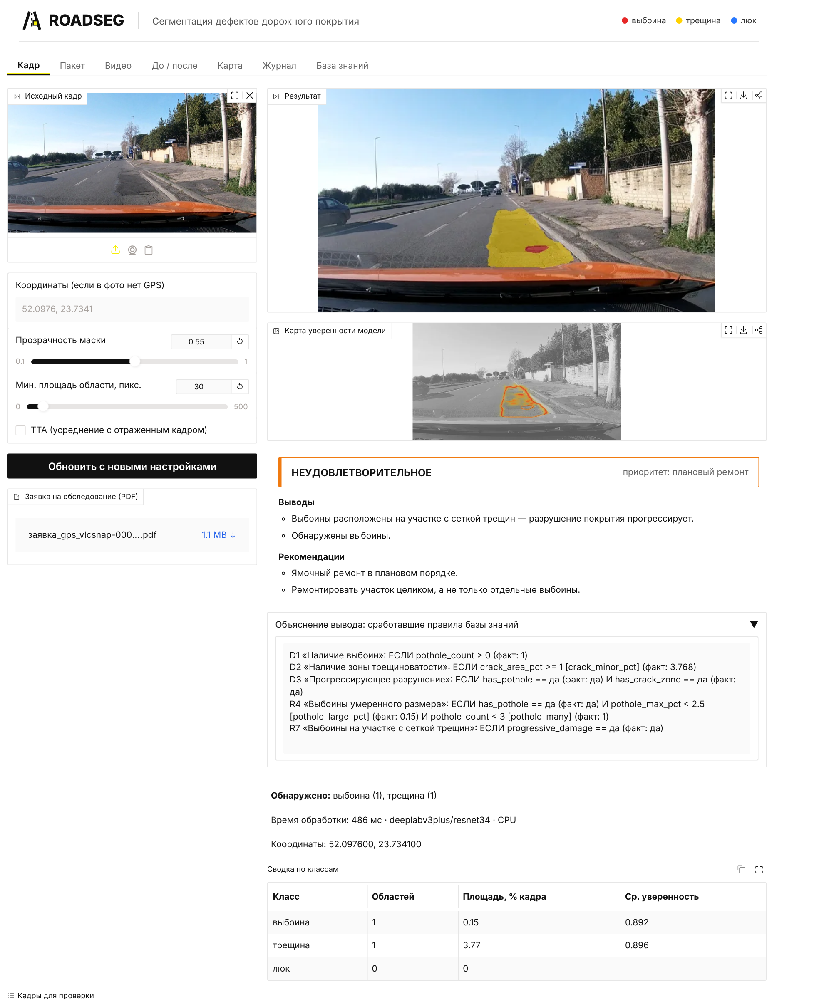
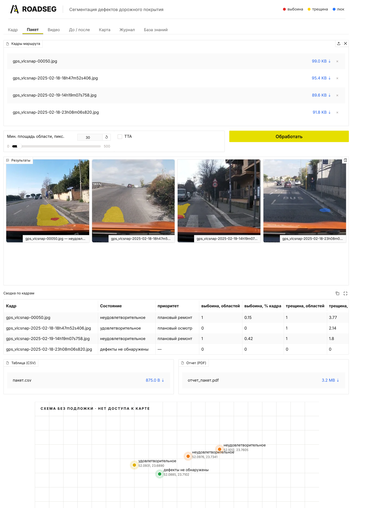
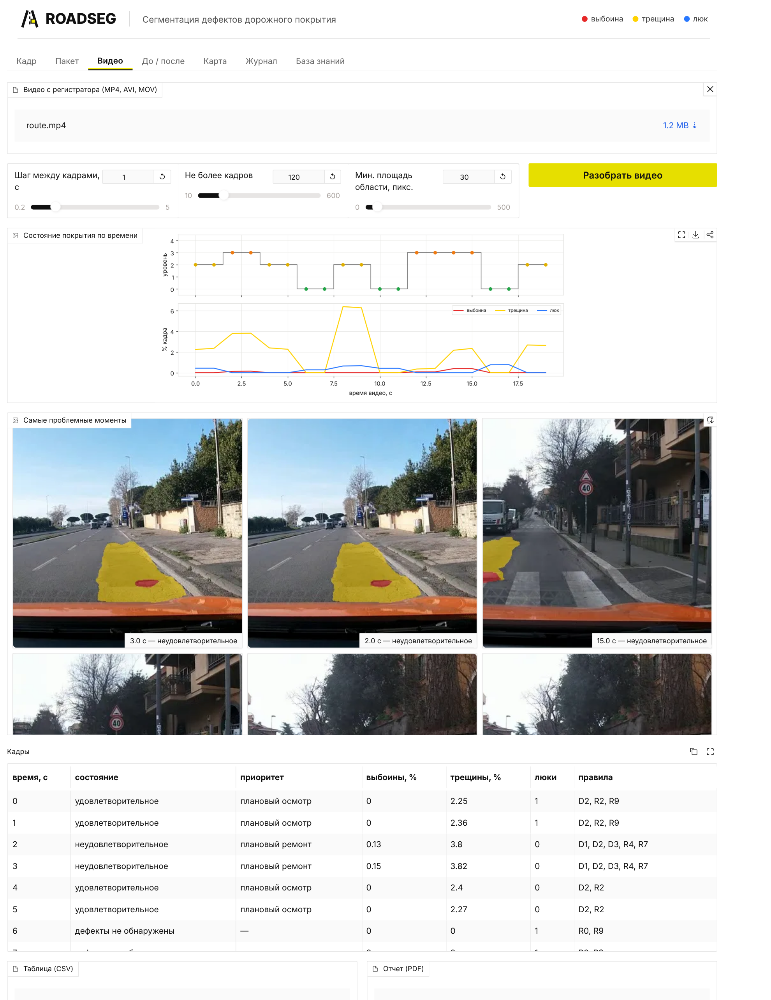
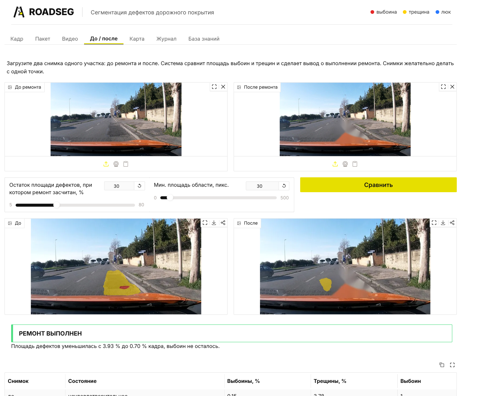
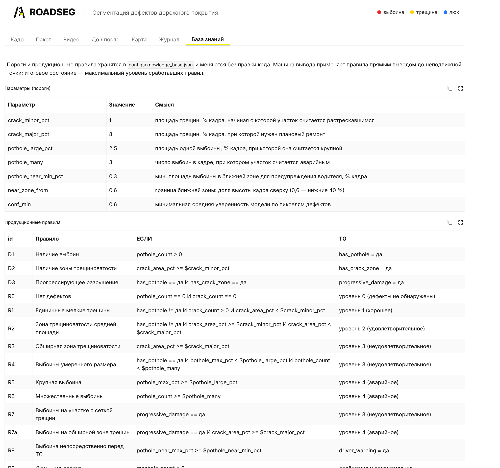
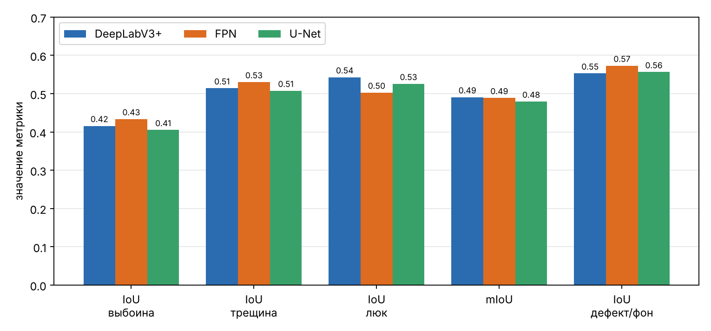
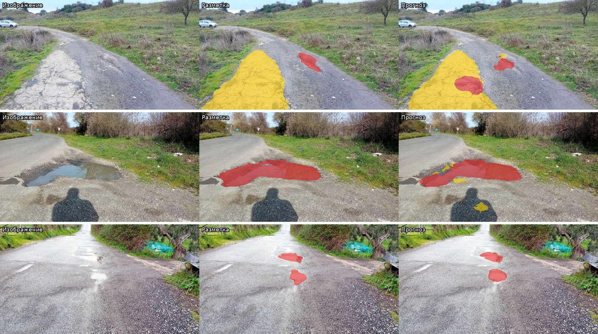
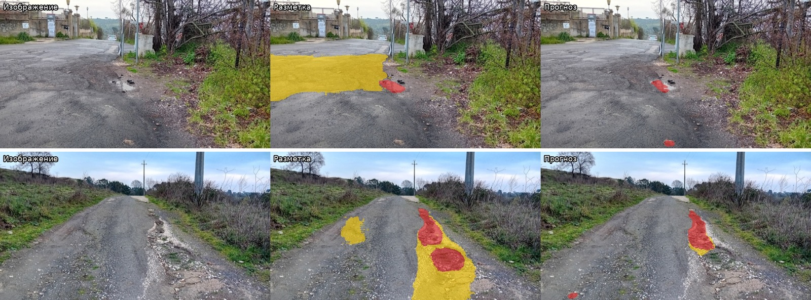
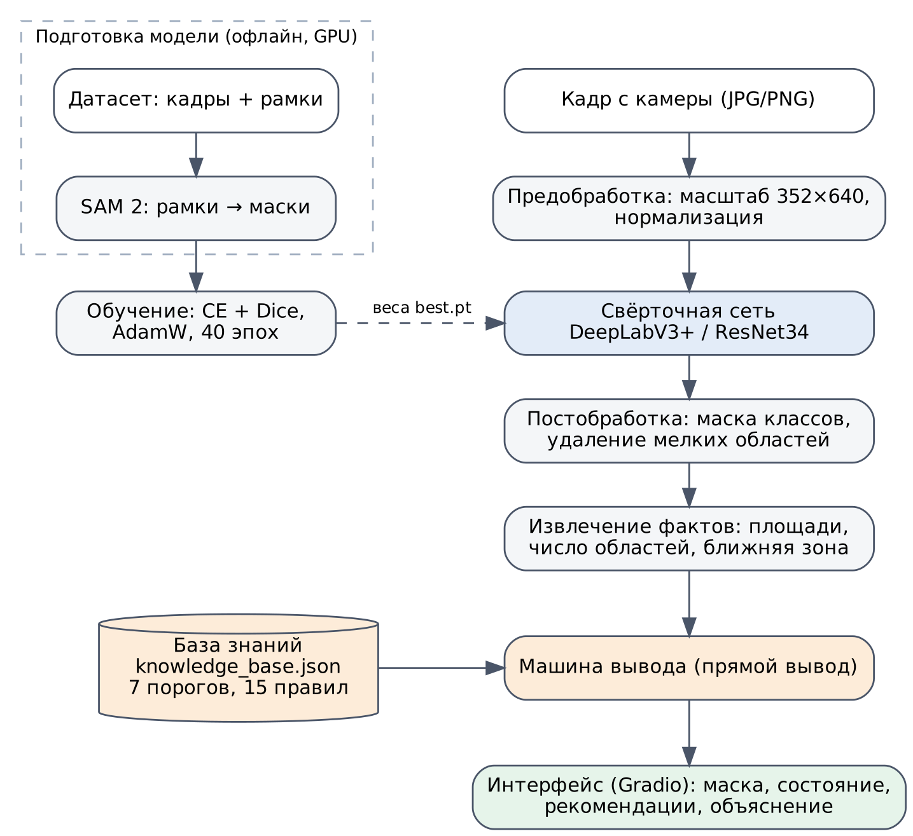
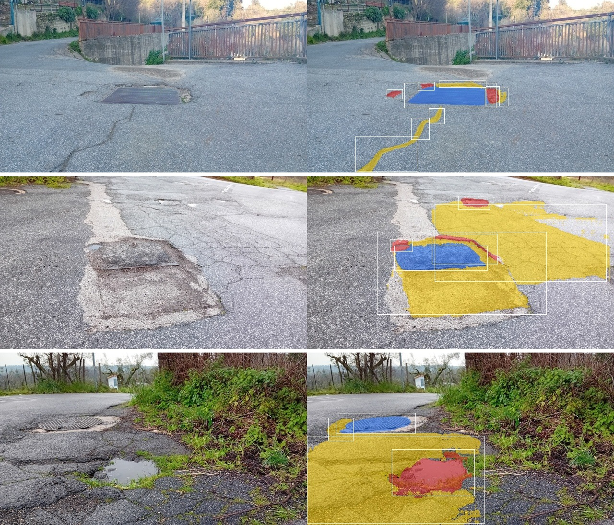

# Сегментация дефектов дорожного покрытия на основе сверточных нейронных сетей

Курсовая работа по дисциплине «Технологии и инструментальные средства проектирования интеллектуальных систем».
БрГТУ, кафедра ИИТ, группа ИИ-26, Черноиван А. Н., 2026.

Программа строит попиксельную маску дефектов по кадру с камеры автомобиля и оценивает состояние покрытия.
Модель различает три класса: **выбоина**, **трещина** (зона трещиноватости) и **люк**. Поверх маски работает
база знаний из 15 правил «ЕСЛИ – ТО», которая выдает уровень состояния участка, приоритет ремонта,
рекомендации и объяснение, почему принято такое решение.



## Содержание

- [Что умеет приложение](#что-умеет-приложение)
- [Быстрый запуск](#быстрый-запуск)
- [Результаты](#результаты)
- [Как это работает](#как-это-работает)
- [Набор данных и разметка](#набор-данных-и-разметка)
- [Обучение своей модели](#обучение-своей-модели)
- [База знаний](#база-знаний)
- [Структура репозитория](#структура-репозитория)
- [Тесты](#тесты)
- [Ограничения](#ограничения)
- [Источники](#источники)

## Что умеет приложение

Веб-интерфейс на Gradio (логотип ROADSEG), семь вкладок:

| Вкладка | Что делает |
|---|---|
| **Кадр** | Маска дефектов поверх кадра, карта уверенности модели (где сеть сомневается), оценка состояния, выводы, рекомендации, объяснение по правилам. Для кадров датасета показывает эталонную разметку и IoU. Координаты берутся из GPS-данных фото (EXIF) или вводятся вручную. Формирует PDF-заявку на обследование участка |
| **Пакет** | Обработка кадров одного маршрута: галерея, сводная таблица, CSV и PDF-отчет, точки на карте |
| **Видео** | Разбор записи с регистратора по кадрам с заданным шагом: график состояния по времени, шесть самых проблемных моментов, таблица, CSV и PDF |
| **До / после** | Сравнение двух снимков участка: «ремонт выполнен», «выполнен частично» или «не выполнен» |
| **Карта** | Все проверенные кадры с координатами, цвет точки — состояние покрытия (OpenStreetMap, без интернета — схема) |
| **Журнал** | История всех проверок (`logs/journal.csv`) с фильтром по состоянию и выгрузкой в CSV |
| **База знаний** | Пороги и все продукционные правила |

| Пакет | Видео |
|---|---|
|  |  |

| До / после | База знаний |
|---|---|
|  |  |

## Быстрый запуск

Веса обученной модели (`weights/best.pt`, DeepLabV3+ / ResNet34) уже лежат в репозитории, обучать ничего не нужно.
GPU не нужен: на обычном процессоре кадр обрабатывается примерно за 0,3 с.

1. Установите **Python 3.10–3.12** с [python.org](https://www.python.org/downloads/).
   На Windows отметьте галочку **Add python.exe to PATH**.
2. Скачайте репозиторий: **Code → Download ZIP** и распакуйте, или
   ```bash
   git clone https://github.com/<ваш-логин>/road-defect-segmentation.git
   ```
3. Запустите:
   - **Windows** — двойной щелчок по `run_app.bat`;
   - **macOS** — правый щелчок по `run_app.command` → «Открыть»;
   - **Linux / вручную**:
     ```bash
     python -m venv .venv
     source .venv/bin/activate            # Windows: .venv\Scripts\activate
     pip install -r requirements-app.txt
     python app.py --ckpt weights/best.pt --examples-dir examples --inbrowser
     ```
4. Откроется http://127.0.0.1:7860. Первый запуск скрипта ставит библиотеки, это занимает 5–10 минут.

Для проверки функций мониторинга есть папка `demo/`:

| Файл | Для чего |
|---|---|
| `gps_*.jpg` | кадры с координатами в EXIF (тестовые координаты, район Бреста) — для карты и отчетов |
| `route.mp4` | 20-секундное видео, склеенное из кадров `examples/` — для вкладки «Видео» |
| `after_repair_retouched.jpg` | кадр `vlcsnap-00050` с закрашенными дефектами (имитация снимка после ремонта) — для «До / после» |

Параметры запуска `app.py`:

| Параметр | По умолчанию | Описание |
|---|---|---|
| `--ckpt` | — | путь к весам модели |
| `--examples-dir` | — | папка с кадрами для быстрого выбора |
| `--data` | `prepared` | папка с `index.csv` (если есть — показывается эталонная разметка) |
| `--kb` | `configs/knowledge_base.json` | файл базы знаний |
| `--journal` | `logs/journal.csv` | файл журнала проверок |
| `--port` | `7860` | порт |
| `--share` | — | публичная ссылка gradio.live (для Kaggle/Colab) |
| `--inbrowser` | — | сразу открыть браузер |

## Результаты

Тестовая выборка — 301 кадр, которые модель не видела при обучении. Метрики считаются по всем пикселям выборки;
среднее берется по трем классам объектов без фона (фон занимает ~97 % пикселей и завышает средние).

| Модель | Параметров, млн | mIoU | mDice | Точность | Полнота | IoU дефект/фон | мс/кадр (T4) |
|---|---|---|---|---|---|---|---|
| **DeepLabV3+** | 22,4 | **0,491** | **0,657** | 0,684 | 0,639 | 0,553 | **17,2** |
| FPN | 23,2 | 0,489 | 0,656 | 0,709 | 0,614 | 0,573 | 17,9 |
| U-Net | 24,4 | 0,479 | 0,646 | 0,648 | 0,651 | 0,556 | 20,7 |

IoU по классам для DeepLabV3+: люк 0,543, трещина 0,514, выбоина 0,416.



Все три архитектуры показали близкое качество (разница около 1 п.п. mIoU), поэтому выбрана DeepLabV3+
как лучшая по mIoU и самая быстрая. Повторный запуск тестирования дал те же метрики.

**Проверка базы знаний.** Для каждого тестового кадра правила применялись к эталонной маске и к маске модели:

- оценка состояния совпала точно на 188 из 301 кадра (62,5 %), с точностью до одного уровня — на 269 (89,4 %);
- решение «участок требует ремонта»: точность 0,776, полнота 0,770;
- предупреждение водителю о выбоине в ближней зоне совпало на 94 % кадров.

| Удачные кадры (IoU 0,89 / 0,76 / 0,70) | Ошибки (IoU 0,03 / 0,16) |
|---|---|
|  |  |

Слева направо на каждой полосе: кадр, эталонная разметка, прогноз. Все файлы метрик, история обучения,
графики и матрицы ошибок лежат в [`docs/results/`](docs/results).

## Как это работает



1. **Предобработка.** Кадр приводится к 352×640 и нормализуется по статистикам ImageNet.
2. **Сегментация.** Сверточная сеть (энкодер ResNet34, декодер DeepLabV3+) выдает вероятности 4 классов
   для каждого пикселя; результат возвращается к исходному размеру кадра.
3. **Постобработка.** Маска классов, удаление областей меньше 30 пикселей.
4. **Факты.** Число и площадь областей каждого класса, крупнейшая выбоина, выбоины в нижних 40 % кадра
   (перед автомобилем), средняя уверенность сети.
5. **Машина вывода.** Продукционные правила применяются прямым выводом, пока появляются новые факты.
   Итог — максимальный уровень среди сработавших правил.
6. **Интерфейс и мониторинг.** Отчеты, журнал, карта, видео, сравнение до/после.

## Набор данных и разметка

[Road Damage Dataset: Potholes, Cracks and Manholes](https://www.kaggle.com/datasets/lorenzoarcioni/road-damage-dataset-potholes-cracks-and-manholes) —
2009 кадров 640×360, 4736 объектов: 1261 выбоина, 2518 трещин, 957 люков. Разбиение 70/15/15 (seed 42):
1407 / 301 / 301 кадров.

В датасете объекты размечены **рамками** (4 точки), а для сегментации нужны **маски**. Маски построены
автоматически: рамка подается подсказкой в модель **SAM 2.1**, ее маска обрезается по рамке (+6 пикселей).
SAM построил маски для 4734 из 4736 объектов, для двух осталась залитая рамка.



Класс «трещина» на практике означает зону трещиноватости: во многих кадрах рамкой обведен целый участок
растрескавшегося асфальта, и SAM выделяет его целиком.

## Обучение своей модели

Удобнее всего на Kaggle (бесплатный GPU):

1. **Create → New Notebook → File → Import Notebook** → `notebooks/kaggle_road_defect_segmentation.ipynb`.
2. **Add Input** → датасет `lorenzoarcioni/road-damage-dataset-potholes-cracks-and-manholes`.
3. **Settings**: Accelerator — GPU, Internet — On (нужен телефон, подтвержденный в профиле Kaggle).
4. **Save Version → Save & Run All (Commit)**. Около 1,5–2 часов; результаты во вкладке **Output** ноутбука.

Ноутбук `notebooks/kaggle_rules_and_interface.ipynb` не обучает модель: он берет готовые веса,
пересчитывает метрики, проверяет базу знаний и запускает интерфейс по публичной ссылке (~15 минут).

Локально (нужен GPU):

```bash
pip install -r requirements.txt
python scripts/prepare_dataset.py --data-root <папка датасета> --out prepared --mask-mode sam
python scripts/train.py --data prepared --arch deeplabv3plus --encoder resnet34 --epochs 40 --out runs/deeplabv3plus_resnet34
python scripts/evaluate.py --ckpt runs/deeplabv3plus_resnet34/best.pt --data prepared --split test --tta
python scripts/evaluate_rules.py --ckpt runs/deeplabv3plus_resnet34/best.pt --data prepared
python scripts/compare_models.py runs/unet_resnet34 runs/deeplabv3plus_resnet34 runs/fpn_resnet34
python scripts/predict.py --ckpt runs/deeplabv3plus_resnet34/best.pt --input examples --out predictions
```

Параметры обучения: AdamW (lr 3·10⁻⁴, weight decay 10⁻⁴), разогрев 200 шагов и косинусное затухание,
пакет 8, 40 эпох с ранней остановкой, функция потерь — взвешенная кросс-энтропия + Dice
(веса классов √(f_фон/f_c), не больше 10), смешанная точность, аугментации Albumentations.
Поддерживаются архитектуры `unet`, `unetplusplus`, `deeplabv3plus`, `fpn`, `pspnet` и любые энкодеры
segmentation_models_pytorch.

## База знаний

Файл `configs/knowledge_base.json`: 7 порогов и 15 правил. Пороги эвристические, подобраны по площадям
дефектов на прогнозах модели, и меняются без правки кода.

| Параметр | Значение | Смысл |
|---|---|---|
| `crack_minor_pct` | 1 % | площадь трещин, с которой участок считается растрескавшимся |
| `crack_major_pct` | 8 % | площадь трещин, при которой нужен плановый ремонт |
| `pothole_large_pct` | 2,5 % | площадь выбоины, при которой она считается крупной |
| `pothole_many` | 3 | число выбоин, при котором участок аварийный |
| `pothole_near_min_pct` | 0,3 % | минимальная выбоина в ближней зоне для предупреждения водителю |
| `near_zone_from` | 0,6 | граница ближней зоны по высоте кадра |
| `conf_min` | 0,6 | минимальная средняя уверенность сети |

Уровни: 0 — дефекты не обнаружены, 1 — хорошее, 2 — удовлетворительное (плановый осмотр),
3 — неудовлетворительное (плановый ремонт), 4 — аварийное (срочный ремонт).
Правила D1–D3 выводят промежуточные факты (есть выбоины, есть зона трещин, разрушение прогрессирует),
R0–R10 — итоговые заключения. Пример объяснения для кадра `vlcsnap-00050`:

```
D1 «Наличие выбоин»: ЕСЛИ pothole_count > 0 (факт: 1)
D2 «Наличие зоны трещиноватости»: ЕСЛИ crack_area_pct >= 1 [crack_minor_pct] (факт: 3.768)
D3 «Прогрессирующее разрушение»: ЕСЛИ has_pothole == да И has_crack_zone == да
R4 «Выбоины умеренного размера»: ... → неудовлетворительное
R7 «Выбоины на участке с сеткой трещин» → ремонтировать участок целиком
```

## Структура репозитория

```
app.py                     веб-интерфейс (Gradio)
run_app.bat / .command     запуск в один щелчок (Windows / macOS)
requirements-app.txt       зависимости для интерфейса
requirements.txt           зависимости для обучения (+ SAM, pytest)
weights/best.pt            веса DeepLabV3+ / ResNet34
examples/                  10 кадров для быстрой проверки
demo/                      кадры с GPS, видео, снимок «после ремонта»
configs/knowledge_base.json  база знаний
src/
  config.py                классы, цвета, размер входа
  labels.py                разбор разметки YOLO (рамка, четырехугольник, полигон)
  masks.py                 маски из полигонов, уточнение SAM 2, визуализация
  data.py                  поиск пар, разбиение, Dataset, аугментации
  model.py                 архитектуры, функция потерь CE + Dice, веса классов
  metrics.py               IoU, Dice, точность, полнота по матрице ошибок
  inference.py             загрузка модели, предсказание, чистка мелких областей
  knowledge.py             факты из маски, база знаний, машина вывода
  monitoring.py            GPS, журнал, PDF-отчет, карта, до/после, видео
scripts/                   prepare_dataset, train, evaluate, evaluate_rules, compare_models, predict
tests/                     52 модульных теста
notebooks/                 ноутбуки Kaggle
tools/build_notebook.py    пересборка ноутбуков из исходников
docs/                      скриншоты, рисунки, метрики и история обучения
```

## Тесты

```bash
pip install -r requirements.txt
python -m pytest -q tests        # 52 passed
```

Покрыты разбор разметки, построение масок, метрики, функция потерь, модели, каждое правило базы знаний,
цепочка прямого вывода, GPS из EXIF, журнал, сравнение до/после, разбор видео, PDF-отчет и карта.

## Ограничения

- Эталонные маски построены моделью SAM 2 автоматически, поэтому метрики показывают согласие с этой
  разметкой, а не с ручной попиксельной.
- Класс «трещина» объединяет отдельные трещины и зоны трещиноватости с нечеткими границами;
  выбоины часто путаются с ними (23,7 % пикселей выбоин отнесены к трещинам).
- Пороги базы знаний подобраны вручную и не привязаны к нормативам по оценке состояния дорог.
- Координаты в `demo/` тестовые, снимок «после ремонта» получен ретушью.

## Источники

1. Ronneberger O. и др. U-Net: Convolutional Networks for Biomedical Image Segmentation. arXiv:1505.04597.
2. Chen L.-C. и др. Encoder-Decoder with Atrous Separable Convolution for Semantic Image Segmentation (DeepLabV3+). arXiv:1802.02611.
3. Lin T.-Y. и др. Feature Pyramid Networks for Object Detection. arXiv:1612.03144.
4. He K. и др. Deep Residual Learning for Image Recognition. arXiv:1512.03385.
5. Ravi N. и др. SAM 2: Segment Anything in Images and Videos. arXiv:2408.00714.
6. Arya D. и др. RDD2020: An annotated image dataset for automatic road damage detection. Data in Brief, 2021.
7. [segmentation_models.pytorch](https://github.com/qubvel-org/segmentation_models.pytorch), [Albumentations](https://albumentations.ai), [Gradio](https://www.gradio.app), [Ultralytics SAM 2](https://docs.ultralytics.com/models/sam-2/).
